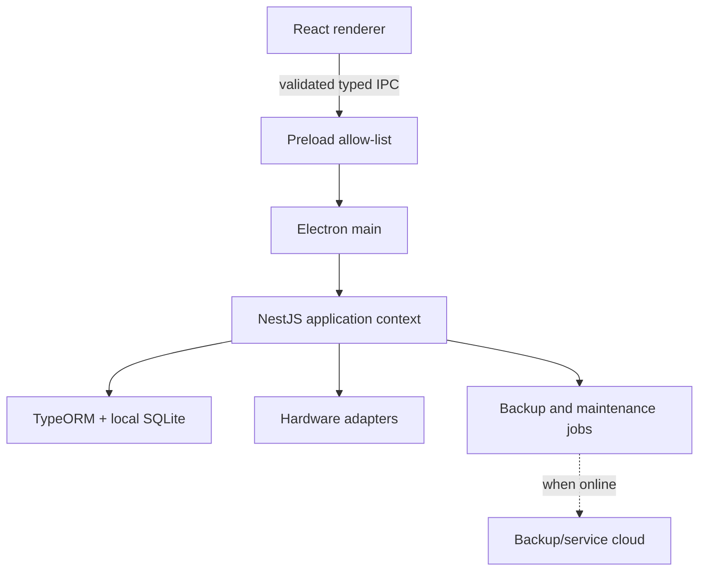

# Architecture

## 1. Runtime topology



The React renderer is untrusted UI. It cannot access the database, filesystem, shell, printer, or cloud credentials directly. Electron main owns process lifecycle and privileged adapters. NestJS owns business rules and transactions.

## 2. Process responsibilities

| Layer             | Owns                                                                            | Must not own                                                    |
| ----------------- | ------------------------------------------------------------------------------- | --------------------------------------------------------------- |
| React renderer    | Screens, local view state, forms, scanner keystroke buffering, user feedback    | SQL, TypeORM entities, filesystem, secrets, stock/money rules   |
| Preload           | Narrow versioned API exposed to renderer                                        | Business logic, generic invoke/pass-through, arbitrary channels |
| Electron main     | Window lifecycle, secure configuration, IPC registration, OS integration        | Domain-rule duplication                                         |
| NestJS context    | Commands, authorization, transactions, repositories, reports, jobs              | Browser/UI concerns                                             |
| TypeORM/SQLite    | Durable local data and constraints                                              | Application authorization decisions                             |
| Hardware adapters | Device-specific protocols                                                       | Pricing, sales, or inventory authority                          |
| Cloud service     | Encrypted backup storage/control metadata, optional subscription/service status | Required dependency for local POS                               |

## 3. Monorepo layout

```text
bakery-store/
├── apps/
│   ├── desktop/          # Electron main, preload, IPC composition
│   ├── backend/          # NestJS modules and domain services
│   └── renderer/         # React application
├── packages/
│   ├── contracts/        # Zod schemas, boundary types, error envelopes
│   ├── database/         # Entities, migrations, seeds, data source
│   ├── shared/           # Pure cross-runtime utilities only
│   └── config/           # Typed build/runtime configuration
├── docs/
└── tests/                # Cross-application and packaged-app tests
```

Do not create dependency cycles. Expected direction:

```text
renderer -> contracts
desktop -> contracts, backend
backend -> contracts, database, shared
database -> shared
contracts -> no app package
```

## 4. Bootstrap and shutdown

Startup sequence:

1. Acquire a single-instance application lock.
2. Resolve approved OS data paths; never write live data inside the packaged application directory.
3. Load validated non-secret configuration and retrieve protected device secrets.
4. Verify database file permissions and make recovery decisions.
5. Create/verify pre-migration backup when a schema upgrade is pending.
6. Initialize SQLite pragmas and TypeORM; run pending migrations under upgrade control.
7. Run database integrity and schema checks.
8. Start the NestJS application context.
9. Register allow-listed IPC handlers and hardware services.
10. Create the window; route first installation to onboarding, otherwise to login.
11. Start background backup/health jobs without blocking POS.

Shutdown stops new commands, waits a bounded period for active transactions, checkpoints WAL safely, stops jobs/hardware, closes the data source and application context, then exits.

## 5. SQLite operating rules

- Enable foreign keys and an agreed busy timeout on every connection.
- Use WAL mode when validated with packaging, antivirus, backup, and restore behavior.
- One application instance is the write authority.
- Do not copy a live `.db` file with a naïve filesystem copy while writes are occurring. Use SQLite's supported backup mechanism or a coordinated checkpoint/snapshot method.
- Run integrity checks after restore and before/after risky upgrades.
- Keep the database on a supported local filesystem, never on a consumer sync folder or network share.

## 6. Failure model

- Cloud unavailable: queue backup/check-in; continue locally; display health state.
- Printer unavailable: complete the committed sale if payment/confirmation policy allows; queue/retry receipt and allow reprint.
- Scanner unavailable: manual search/touch remains available.
- Migration fails: block normal startup, preserve evidence, and enter recovery workflow.
- Database busy: bounded retry for safe operations; never duplicate a command.
- App dies during transaction: SQLite rollback ensures all-or-nothing; startup reconciliation detects incomplete drafts/jobs.
- Power loss after commit but before printing: sale remains posted and receipt is reprintable.

## 7. Future extension boundary

Nest services remain transport-independent so a future LAN API, cloud sync worker, or web administration layer can call the same application services. This future capability is not permission to expose HTTP in V1.
