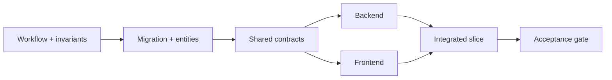

# Database-First Development

## 1. Meaning of database-first

Database-first does not mean building every table before validating workflows. It means each vertical slice begins by freezing its data invariants, migration, constraints, transaction boundary, and shared contract before backend and frontend implementation.



## 2. Design order

For each slice:

1. Write normal, correction, cancellation, retry, offline, and power-loss scenarios.
2. Identify aggregate roots and authorities for money, stock, status, and numbering.
3. Define tables, columns, precision, constraints, indexes, and retention.
4. Define immutable/posting behavior and reversal links.
5. Define one-way migration and tested downgrade/recovery strategy.
6. Define command and response schemas in `packages/contracts`.
7. Implement repositories/services and the UI in parallel.
8. Prove reconciliation and acceptance criteria before starting the next dependent slice.

## 3. Global database rules

- IDs are stable and generated before retryable writes where practical.
- Store timestamps in UTC; store bakery timezone separately for business-day rendering.
- Money: integer minor units and ISO-style currency code; tax and percentage rates use scaled integers/decimals with documented scale.
- Quantities: decimal values with explicit scale; normalize ledger quantities into each item's base unit.
- Human document numbers are not primary keys and are allocated transactionally.
- Use database constraints for uniqueness and referential integrity, not only UI validation.
- Use partial/conditional uniqueness or equivalent service guards where SQLite support/ORM behavior requires care.
- Soft deletion is not a substitute for audit. Referenced master data becomes inactive; posted documents are reversed, not removed.
- Denormalized totals may be stored on posted documents for historical truth, but reports must reconcile them to lines/payments/movements.

## 4. Aggregate transaction boundaries

| Command               | Atomic writes                                                                |
| --------------------- | ---------------------------------------------------------------------------- |
| Post goods receipt    | receipt, lines, lots, stock movements, cost evidence, audit/outbox           |
| Complete sale         | sale, lines, totals, payments, stock movements, cash movements, audit/outbox |
| Refund sale           | refund, refund lines/payments, reversal stock/cash effects, audit/outbox     |
| Complete production   | run, ingredient consumption, finished output, lots, variances, audit/outbox  |
| Confirm stock count   | count lines, calculated adjustments, stock movements, approvals, audit       |
| Close shift           | declared amounts, expected amounts, variance, close status, audit            |
| Confirm opening stock | session, rows/lots, opening movements, lock/go-live evidence, audit          |

## 5. Draft versus posted state

Drafts may be changed. Posting performs validation and creates authoritative effects. Posted records are immutable except for tightly limited metadata explicitly documented as non-financial/non-stock.

Typical lifecycle:

```text
DRAFT -> POSTED -> REVERSED or CORRECTED
```

Deletion is allowed only for safe drafts and always subject to permission/audit policy.

## 6. Concurrency and retry

- Every posting command includes an idempotency key unique per installation/operation.
- Repeated requests return the first committed result instead of writing twice.
- Optimistic version fields protect editable drafts where concurrent UI actions are possible.
- Long calculations happen before the shortest possible write transaction, but authoritative values are revalidated inside the transaction.
- Never call cloud services or wait for a printer inside a database transaction.

## 7. Seed data

Migrations change structure. Seeds provide controlled baseline data such as permission keys, system movement types, and default units. Client catalog, opening stock, users, and recipes are onboarding data, not deployment seeds.
