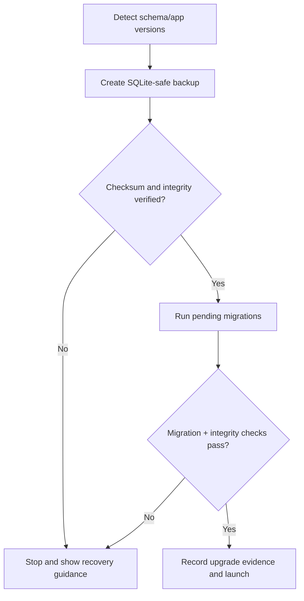

# Migration and Schema Lifecycle Plan

## 1. Mandatory configuration

Production and client builds use:

```ts
synchronize: false;
migrationsRun: false;
```

The controlled desktop bootstrap owns migration decisions. Tests may use isolated schema setup only when it cannot mask production migration defects.

## 2. Initial migration order

1. System metadata, store, installation, register, settings.
2. Users, roles, permissions, approvals, audit.
3. Units, conversions, categories, tax classes.
4. Items, products, variants, barcodes, price history.
5. Suppliers and supplier items.
6. Locations, lots, stock ledger, balance projection.
7. Purchase orders, goods receipts, returns.
8. Recipes, versions, ingredients, production runs.
9. Customers and custom orders.
10. Shifts, cash movements, sales, payments, refunds.
11. Imports, opening stock, backup/restore, jobs, outbox.
12. Indexes, reconciliation views/queries, baseline permission seed.

Migration filenames use monotonically ordered timestamps plus a descriptive name. Do not put unrelated domain changes into one migration merely to reduce file count.

## 3. Development workflow

1. Change entity/model and write or generate a migration.
2. Review SQL in both `up` and `down`; generated SQL is not automatically trusted.
3. Test from an empty database.
4. Test upgrading every supported prior release fixture.
5. Test failure/interruption and recovery behavior.
6. Run integrity and reconciliation checks.
7. Commit entity, migration, contract, tests, and documentation together.

## 4. Client upgrade workflow



Never open the normal application on a half-upgraded database. Preserve logs and backup references needed for support.

## 5. SQLite migration cautions

- Rebuilding a table may be required for constraints or column changes. Explicitly copy, validate, swap, and recreate indexes/triggers.
- Do not assume a down migration is safe after the new application has written data in a new shape.
- Prefer forward-fix releases; use pre-upgrade restore for failed client upgrades when rollback could lose information.
- Large backfills must be measured on a realistic client database and provide progress without holding UI hostage indefinitely.
- Schema compatibility is checked before running the application context.

## 6. Migration tests

Required fixtures:

- Empty database.
- Previous production release database.
- Realistic large anonymized database.
- Database containing edge-case decimals, old inactive masters, refunds, partial receipts, lots, recipe versions, and held carts.
- Interrupted/failed migration simulation.

Required assertions:

- Schema version correct.
- Foreign-key check clean.
- Integrity check clean.
- Row counts and historical totals preserved.
- Stock, payments, shifts, tax, and report reconciliation unchanged unless the migration explicitly and correctly transforms them.
- Application can start, read, post a test transaction, back up, and restore after upgrade.
