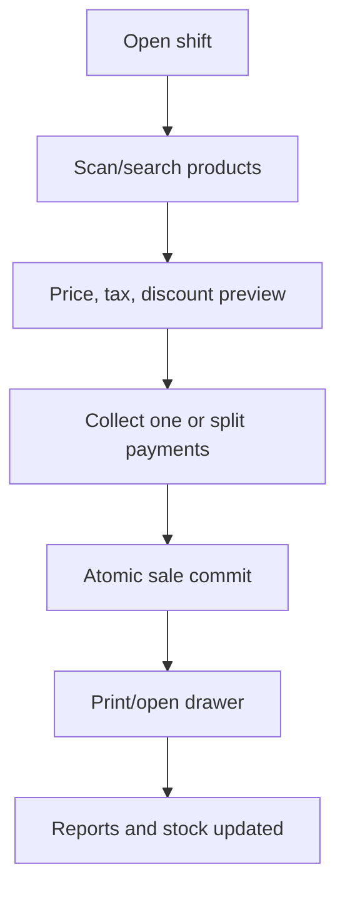

# POS Sales, Payments, Refunds, and Shifts

## 1. Sale flow

Printing occurs after commit. A printer failure must not create a second sale; the original receipt is reprintable.

## 2. Cart rules

- Cart lines reference variants but display calculated snapshots.
- Quantity may be count or measured according to item/unit rules.
- Current price/tax/availability are resolved by backend preview and revalidated at completion.
- Line/order discounts respect permission, reason, maximum, tax order, and rounding configuration.
- Hold/resume stores a draft only and reserves stock only if explicitly scoped.
- Services/non-stocked products do not create stock movements.

## 3. Completing a sale

The backend transaction:

1. Confirms authenticated cashier, open shift/register, permissions and idempotency.
2. Loads current product/tax rules and validates stock policy.
3. Recalculates subtotal, discount, tax, total, tender allocation, due and change.
4. Creates sale and immutable line snapshots.
5. Creates payment and cash-movement records.
6. Creates negative stock movements for stocked lines using the chosen lot/cost method.
7. Links custom order/deposit/customer data where applicable.
8. Writes audit/outbox evidence and commits.

Cash change is not a negative payment. Payment records and cash movement rules must reconcile exactly.

## 4. Split payments

The sum of applied payments equals the amount due, except cash tender may exceed due and produce explicit change. Card/reference validation is configurable; the system must not claim a card is settled when it only records a manual method.

## 5. Refunds and voids

- Pre-completion cart line removal is not a refund.
- A completed sale is never edited or deleted.
- Refund selects original sale/lines, remaining refundable quantity, disposition/restock, method, reason, and approval.
- Refund transaction creates linked refund lines, negative payment/refund effects, stock restoration or damaged/waste disposition, cash movement, and audit.
- Receipt reprint is labeled `COPY`; it does not repost anything.
- Post-commit void, if supported, is a full controlled reversal, not deletion.

## 6. Shift and cash control

Shift open records register, cashier, time, and opening cash. Controlled pay-in/payout records amount and reason. Shift close captures counted amounts per method, calculates expected values from authoritative payments/cash movements, records variance and approval, and locks the shift.

Reports distinguish business date from UTC timestamps and follow the configured bakery timezone/cutoff.

## 7. Training mode

Training/test sales are visibly marked and excluded from live tax, cash, stock, customer balance, and sales reports. Prefer an isolated training workflow/database rather than trying to reverse contaminated production data.

## 8. Acceptance criteria

- Cash, card/manual non-cash, exact, over-tender/change, and split payment reconcile.
- Discount/tax/rounding fixtures match approved client examples.
- Duplicate click/retry produces one sale.
- Stock and cost effects reconcile per line.
- Printer/drawer failure does not roll back or duplicate a committed sale.
- Partial/full refund limits, restock choice, and cash effects reconcile.
- Shift expected cash equals opening cash plus authoritative movements; variance is explicit.
