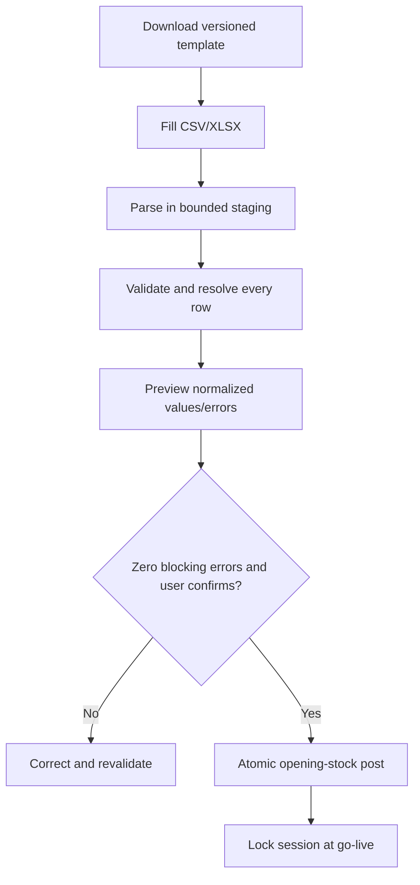

# Bakery Onboarding and Imports

## 1. Goal

The client must be able to install, configure, test, and go live without a developer editing the database or configuration files.

First launch routes to a resumable setup wizard until `SETUP_COMPLETE` is recorded through the controlled go-live command.

## 2. Two onboarding modes

### Quick start

1. Bakery/store information.
2. Client super-admin account.
3. Currency, timezone, tax and critical stock/POS policies.
4. Printer and scanner test.
5. Products/barcodes by manual entry or import.
6. Opening stock by manual entry or CSV/XLSX import.
7. Local backup and optional cloud backup verification.
8. Training purchase/sale and go-live checklist.

### Full setup

Adds roles/users, suppliers, ingredients, units, recipes, production, custom orders, label printer/scale/drawer, advanced permissions, and complete report settings.

Incomplete optional steps may be deferred, but critical go-live gates may not be skipped silently.

## 3. Wizard state

- Persist current step, completed steps, validation evidence, actor, and timestamps.
- Reopening the app resumes safely.
- Administrators may revisit configuration after go-live through settings, subject to permissions.
- Go-live records who confirmed it and freezes the opening-stock session.

## 4. Catalog import

Provide a versioned downloadable CSV/XLSX template with columns such as:

```text
SKU, Barcode, Item Name, Item Type, Category, Variant,
Sale Price Minor, Tax Class, Base Unit, Purchase Unit,
Purchase Conversion, Shelf Life Days, Track Lot, Track Expiry,
Reorder Level, Supplier Code, Active
```

Exact columns depend on import type. Money template instructions must make currency units unambiguous; internal storage converts to minor units.

## 5. Opening-stock import

Opening stock supports CSV and XLSX. Recommended columns:

```text
SKU, Barcode, Item Name, Item Type, Category,
Quantity, Unit, Unit Cost, Lot Number, Expiry Date,
Supplier, Location
```

Flow:



Example: `75 kg` flour with gram base unit posts `+75,000 g` through `OPENING` movements. No import directly edits a balance.

## 6. Validation

Before any write, detect:

- Missing required fields and unsupported template version.
- Duplicate rows, SKUs, barcodes, document references, or ambiguous identifiers.
- Unknown category, unit, location, supplier, tax class, or item.
- Unit-dimension mismatch and invalid conversions.
- Invalid/negative quantity or cost, invalid dates, expiry before receipt/opening date.
- Lot/expiry missing for an item that requires it.
- Conflicts with existing records and rows that would create unsafe implicit masters.

Show row number, field, error code, human explanation, original value, normalized value, and suggested correction. Warnings require acknowledgement; errors block confirmation.

## 7. Import transaction and retry

- File content hash plus import type identifies accidental re-upload.
- Parsing/preview writes only staging/import-session data.
- Confirmation is idempotent and atomic for the controlled batch or documented chunks with resumable status.
- If confirmation fails, no partial stock/session effects remain.
- Store template version, source hash, actor, validation summary, confirmation time, and result counts.

## 8. Hardware and backup onboarding

Each configured device has detect/configure/test/save where possible. The wizard must receive a test scan and print a test receipt. It creates and verifies a local backup; when cloud is enabled, it uploads and verifies the first encrypted backup.

## 9. Mandatory training/UAT steps before go-live

- Receive a test purchase and prove stock increase.
- Perform a training sale, payment, receipt, and prove expected stock/report behavior without contaminating live accounts.
- Prove local backup and restore using test data.
- Prove cloud backup and controlled restore in the installation/UAT environment when cloud service is included.
- Record acknowledged deferred setup items.

## 10. Go-live rules

Go-live requires client super-admin confirmation, no blocking diagnostics, a locked opening-stock session or explicit zero-opening-stock decision, verified backup destination, and completed required hardware/workflow tests. After go-live, opening stock cannot be reopened; corrections use stock count/adjustment.
